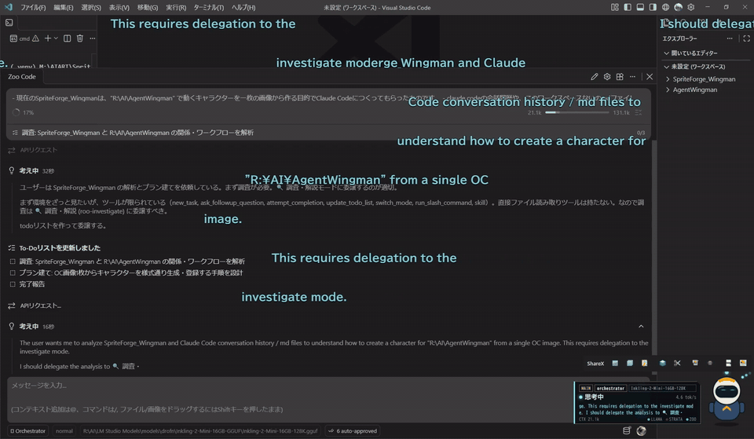
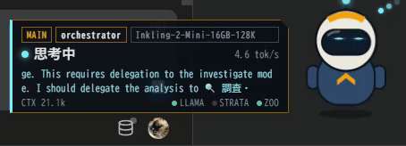

# AgentWingman

タスクバーの上に小さなキャラクターが常駐して、AI エージェントやローカル LLM サーバーなどの状況を小さく表示し、
**質問・承認待ち・完了・エラー** のときに合図を出すアプリです。

ウィンドウを閉じてゲームをしていても、「今どうなっているか」「呼ばれているか」が一目で分かることを目的にしています。
何を見張るかは **アドオン** で決まります。同梱は Strata / SyncStrata（ローカル LLM サーバー）、Claude Code、
llama.cpp（llama-server のログ）、Zoocode（VS Code 拡張）、Webhook（汎用の受け口）で、ほかのツール用のアドオンも
自分で作れます（[ADDONS.md](ADDONS.md)、AI に作らせる場合は [docs/AI_ADDON_GUIDE.md](docs/AI_ADDON_GUIDE.md)）。





## ダウンロード

[Releases](../../releases) から `AgentWingman-<版>-win.zip` をダウンロードし、好きな場所に展開して `AgentWingman.exe` を起動します
（Windows 10 / 11、64bit）。インストールは不要で、Node.js も要りません。消すときはフォルダと `%APPDATA%\agent-wingman\` を削除します。
署名していないので、初回は Windows SmartScreen の「詳細情報 → 実行」が必要な場合があります。

## キャラクターの合図

| 状態 | キャラクター |
|---|---|
| 待機中 | ゆっくり呼吸・まばたき |
| プロンプト読込中 | 目が左右に走査 |
| 思考中 | 目が上を向き「…」。思考内容がパネルに流れる |
| 回答作成中・作業中 | キーボードを打つ |
| **質問があります** | 「!」を出して跳ねる＋音。答えるまで吹き出しが残る |
| **承認待ち** | 手を振る＋音 |
| **タスク完了** | バンザイ＋星＋音 |
| **エラー** | 震えて汗＋音 |
| コンテキスト圧縮・サブタスク出撃/帰還 | 一回だけ吹き出しで反応 |
| 接続なし | 灰色で目を閉じる |

パネルには MAIN / SUB n、モード名、モデル名、tok/s、コンテキスト量、思考内容が出ます（どのアドオンが何を出すかは各アドオン次第）。
何も起きない状態が20秒続くとパネルは畳まれ、マウスを乗せると開きます。

## 操作

- **キャラクターをクリック**：ランチャーを開く／閉じる（いつでも。合図の吹き出しも消えます）
- **キャラクターかパネルをドラッグ**：移動（位置は保存されます）
- **パネルの左端・上端・左上の角をドラッグ**：大きさを変える。上端で全体が拡大・縮小、左端でパネルの幅が変わります
- **キャラクターかタスクウィンドウを右クリック**：トレイと同じ設定メニュー
- **タスクトレイのアイコン**（左クリックで表示/非表示、右クリックで設定メニュー）

| トレイのメニュー | 内容 |
|---|---|
| 一時的にすべて隠す | ウィンドウごと隠す。トレイのアイコンを左クリックで戻ります |
| 表示項目 | キャラクター、タスクウィンドウ（キャラクター左の情報欄まるごと）、その中の各行（タスク情報／状態／リアルタイム思考内容／コンテキスト量・接続状態）を個別にオン/オフ。画面に何も残らなくなる切り替えはできません |
| キャラクターの種類 | 標準のパイロットと、自作の画像キャラクターを切り替え |
| アドオン | 見張る対象のオン/オフ、アドオンフォルダ、設定 |
| サウンド | 合図の音 |
| 大きさと位置を元に戻す | 右下・標準サイズに戻す |

キャラクターをオフにしても、合図は吹き出しで出ます。

## 画面オーバーレイ

画面全体に透明な層を重ねて、AI の思考や合図を [kusa_commenter](../kusa_commenter_LM_Studio) 風に表示します。
クリックはすべて下に通るので、作業やゲームの邪魔にはなりません。トレイ → 画面オーバーレイ → 使う でオンにします（初期状態はオフ）。
オンにした瞬間に4種類の見本が一度だけ出ます。あとは AI が動いたときだけ表示されます（「テスト表示」でいつでも見本を出せます）。

内容ごとに、表示のしかたを選べます（トレイ → 画面オーバーレイ → 各項目）。

| 表示のしかた | 見た目 |
|---|---|
| ニコニコ風（流れる） | 右から左へ流れるコメント。行（レーン）に振り分けられます |
| 通知（右下） | 右下に積み重なり、3.5秒で消える通知 |
| チャット欄（左下） | 左下に新しい行が下へ増えていくログ。各行は2秒後から6秒かけて消えます |
| 大きく（画面中央） | 画面中央を横切る帯に大きな文字（質問＝橙、承認＝オレンジ、完了＝緑、エラー＝赤） |

| 内容 | 初期設定 |
|---|---|
| 思考内容 | ニコニコ風（文の区切りや約40文字ごとに切って流します） |
| 作業内容（タスクウィンドウに灰色で出る行。Claude Code が実行中のツールなど） | ニコニコ風（新しい行が出るたびに灰色のコメントで1回） |
| 回答 | チャット欄 |
| 合図（質問・承認・完了・エラー） | 大きく（画面中央） |
| 出来事（コンテキスト圧縮・サブタスク・アドオンのイベント） | 通知 |
| 状態の変化（思考中・待機中など） | 出さない |

細かい設定は `config.json` の `overlay`（レーン数 `lanes`、流れる速さ `scrollSpeed`、文字の大きさ `fontSize`、
不透明度 `opacity`、通知の下端からの位置 `toastBottom`、チャット欄の幅 `chatlogWidth`・行数 `chatlogLines`・
消え始めるまで `chatlogHoldSeconds`・消える時間 `chatlogFadeSeconds`（0 で消えない）・薄さ `chatlogOpacity`）で変えられます。
思考や回答のように少しずつ届く文章は、「通知」と「大きく」では1つの表示を書き換えながら出し、止まると消えます（たまって遅れることはありません）。
`npm run snapshot:overlay` で見た目を `snapshots/overlay/` に書き出せます。

## ランチャー

何も動いていない状態（待機中・接続なし）が30秒続くと、キャラクターの横にショートカットのタイルが吹き出しで出ます。
待機中にキャラクターをクリックしても開閉できます。何かが動き始めると自動で閉じます。

- **追加**：「＋ 追加」タイル、またはトレイ → ランチャー から、アプリ・ファイル・ショートカット（.lnk）・フォルダを選ぶ。タイルにドラッグ＆ドロップでも追加できます
- **編集**：タイルを右クリック → 開く／保存場所を開く／左右に移動／ランチャーから外す
- アイコンは Windows から自動で取得します。見つからなくなったものは薄く表示されます
- 表示名は `config.json` の `launcher.items[].label` で変えられます

## exe 版

```
npm run dist
```

`dist\AgentWingman-<版>-win.zip`（約115MB）と、展開済みの `dist\win-unpacked\` ができます。
zip を好きな場所に展開して `AgentWingman.exe` を起動します。Node.js やこのフォルダが無くても動きます。

- 設定・ログ・自作キャラクター・自作アドオンは開発版と同じ `%APPDATA%\agent-wingman\` を使います（開発版と同時には起動できません）
- 署名していないので、初回は「Windows によって PC が保護されました」と出ることがあります。「詳細情報」→「実行」で起動できます
- **Node.js は不要です。** Claude Code のフックと llama.cpp の `tap.js` は、Node.js が入っていればそれで、
  無ければ `AgentWingman.exe` 自身で動かします（トレイから登録・作成した場合）
- フックや Wingman 版 bat は exe の場所を覚えます。exe のフォルダを移動したら、トレイから登録し直す／作り直してください
- トレイの「Windows の起動時に起動」で自動起動できます（exe 版のみ）

## トレイからできる連携の準備

| メニュー | 内容 |
|---|---|
| アドオン → Claude Code のフック → 登録する… / 外す… | `~/.claude/settings.json` にフックを登録・削除（確認画面あり、変更前にバックアップ） |
| アドオン → llama.cpp の bat を Wingman 版にする… | 選んだ bat の隣に `_wingman.bat` を作ります（元の bat は変更しません） |
| ランチャー → llama.cpp の bat は Wingman 版にして登録 | オンのとき、ランチャーに llama-server の bat をドロップすると、Wingman 版を作ってそれを登録します |

Wingman 版は元の bat のコピーなので、あとで元の bat を書き換えても Wingman 版には反映されません。
元を変えたら、Wingman 版を消してから作り直してください。

## ログ

`%APPDATA%\agent-wingman\logs\wingman.log`（トレイ → ログを開く）。起動情報、設定の保存、アドオンの開始・停止・エラー、
キャラクターの読み込み、画面側のエラーを記録します。会話の内容（依頼・思考・回答）は記録しません。
512KB を超えると `wingman.1.log` に移して新しく始めます。設定の保存に失敗したときは吹き出しでも知らせます。

## 動かし方

```
npm install      # 初回だけ（Electron を取得します）
start.cmd        # または npm start
```

初めて起動したときはアドオンがすべてオフです。トレイ → アドオン で使うものにチェックを付けてください。

| コマンド | 内容 |
|---|---|
| `npm test` | **全体の検査**（構文、同梱キャラクター、形式の版、全アドオン、画面、オーバーレイ、キャラクターメーカー）。`npm run dist` の前に自動で実行され、1つでも失敗すると exe は作られません。`npm run test:quick` は画面系を省いた速い版 |
| `npm run maker` | キャラクターメーカーを開く |
| `npm run demo` | 全状態を4.5秒ずつ順番に表示（アドオン不要） |
| `npm run snapshot` | 全状態を `snapshots/builtin/*.png` に書き出す（`-- --skin <名前>`、`-- --hide character,footer`、`-- --frames 4`（状態ごとに複数枚）も可） |
| `npm run snapshot:sprite` | サンプルの画像キャラクターで同上 |
| `npm run export-guide` | 標準パイロットから見本画像とサンプル画像を作り直す |
| `npm run check:zoo` / `check:strata` | アドオンの読み取り部分だけをコンソールで試す |

## キャラクターの差し替え

ポーズ画像を用意すると、自分のキャラクターに差し替えられます。動き（呼吸・跳ねる・震える）と記号（…、！、星、汗）は
アプリが付けるので、画像は止まったポーズだけで済みます。画像生成 AI にキャラクター画像と見本を渡して作れるよう、
見本画像とプロンプトを用意しています。

- 作り方: [characters/_template/README.md](characters/_template/README.md)
- AI 用プロンプト: [characters/_template/PROMPTS.md](characters/_template/PROMPTS.md)
- 見本画像: `characters/_template/guide/`（全ポーズ一覧は `_all_poses.png`）
- サンプル: `characters/pilot-sprite/`（標準パイロットを緑背景の画像にしたもの）、`characters/mannequin-anim/`（多コマ PNG のマネキン）

**キャラクターメーカー（動画からキャラクターを作る）**

右クリック → キャラクターの種類 → **動画からキャラクターを作る…**（`AgentWingman.exe --maker` でも起動できます）。
状態ごとに動画・GIF・アニメ PNG / WebP・連番画像・静止画を入れると、背景を抜き、全状態の大きさと足元の位置をそろえて、
透過 PNG のキャラクターを作ります（待機だけ必須）。ComfyUI・Python は不要です。

**動画（透過 WebM）でも書き出せます**（おすすめ。なめらかで軽い。PNG は予備として一緒に残ります）。
これには ffmpeg が必要で、AgentWingman には同梱していません。PATH に ffmpeg があればそれを使い、無ければメーカーの
「ffmpeg をダウンロードして動画を作れるようにする」ボタンで入手できます（確認画面のあと、github.com/BtbN/FFmpeg-Builds の
LGPL 版の最新安定版をダウンロードし、チェックサムを照合して `%APPDATA%\agent-wingman\tools\ffmpeg\` に置きます。約160MB）。
アプリ内蔵の Chromium は透過付きの動画を書き出せない（WebCodecs のアルファ非対応）ため、ffmpeg を使っています。
できたキャラクターはユーザー用キャラクターフォルダに保存され、動いている AgentWingman が自動で切り替えます。

キャラクターメーカーは本体とは別のプロセスで動き、本体のコードを共有しません（つながりはキャラクターの形式
`skin.json` の `"format": 1` だけ）。作成中に本体が重くなったり、メーカーが落ちて本体が止まったりすることはありません。

**キャラクターを置く場所**（下にあるものほど優先。同じ名前なら下の方が使われます）

| 場所 | 用途 |
|---|---|
| アプリに同梱の `characters\` | exe 版では、exe を作った時点のものが入っています（あとから足しても exe には入りません） |
| exe と同じフォルダの `characters\` | 配布した exe の隣に置くだけで使えます（exe 版のみ） |
| トレイ → キャラクターの種類 → **キャラクターを探すフォルダを追加…** で追加したフォルダ | SpriteForge_Wingman の出力先など、好きなフォルダ。キャラクターのフォルダそのものを選ぶと、その親フォルダを追加してそのキャラクターに切り替えます |
| `%APPDATA%\agent-wingman\characters\`（ユーザー用キャラクターフォルダを開く） | 開発版・exe 版で共通の置き場所 |
- 多コマ PNG・透過動画（WebM）にも対応しています。ComfyUI で作る場合は SpriteForge_Wingman（ComfyUI 用の別ツール）を使います

## 同梱アドオン

| アドオン | 内容 | 必要なもの |
|---|---|---|
| Strata / SyncStrata | 読込中・思考中・回答中、tok/s、モデル名。Strata は Thinking と回答のリアルタイム本文も | Strata の本文表示には起動設定に `"api_monitor": true`。SyncStrata は設定不要（本文は未対応）。SyncStrata がポートを変えても自動で追いかけます |
| Zoocode | 質問・承認待ち・完了・エラー、モード、サブタスクの深さ、コンテキスト圧縮 | VS Code 拡張 Zoocode / Roo Code。内部ファイルを読むため拡張の更新で動かなくなることがあります |
| Webhook | `http://127.0.0.1:8768` に送られた状態・合図をそのまま表示 | 送る側（curl、自作スクリプトなど） |
| Claude Code | 承認待ち・入力待ち・完了・エラー・圧縮・サブエージェント。複数セッション対応 | Claude Code へのフック登録（[addons/claude-code/README.md](addons/claude-code/README.md)） |
| llama.cpp（ログ連携） | 思考と回答のリアルタイム本文、tok/s、CTX。**アプリの接続先は 8080 のまま** | llama-server の起動 bat を AgentWingman 版にする（[addons/llama-log/README.md](addons/llama-log/README.md)） |

詳しい使い方と自作の方法は [ADDONS.md](ADDONS.md) にあります。
新しいエンジンやエージェントへの対応を AI に頼むときは、[docs/AI_ADDON_GUIDE.md](docs/AI_ADDON_GUIDE.md) を渡してください
（調査の手順、方式の選び方、守ること、落とし穴、自動検査 `tools/addon-harness.js`、そのまま使える依頼文の雛形）。

## 設定

設定ファイルは `%APPDATA%\agent-wingman\config.json` です（トレイ → アドオン → 設定を開く）。変更後はアプリを再起動してください。

| キー | 既定値 | 内容 |
|---|---|---|
| `sound` | `true` | 合図の音 |
| `character` | `"builtin"` | 使うキャラクター（`characters` 内のフォルダ名） |
| `characterDirs` | `[]` | キャラクターを探す追加のフォルダ（トレイから追加・削除できます） |
| `show` | すべて `true` | 表示項目（`character` / `tags` / `state` / `thinking` / `footer`） |
| `tailLines` | `2` | 思考内容の表示行数 |
| `launcher` | — | `enabled`（使う）、`autoShow`（自動で出す）、`idleSeconds`（何秒待ってから出すか）、`items`（`{label, path}` の並び） |
| `addons` | `{}` | アドオンごとの `enabled` と `settings` |
| `alwaysOnTopLevel` | `"screen-saver"` | ボーダーレス全画面のゲームの上にも出す。排他的フルスクリーンの上には出せません |
| `position` / `size` | `null` | ドラッグ後の位置と大きさ |

## 注意

- キャラクターの動きはアプリの合図そのものなので、Windows の「アニメーションを表示しない」設定には従いません。
- アドオンは本体と同じ権限で動くプログラムです。信頼できるものだけを入れてください。

## 構成

```
src/main.js          ウィンドウ、トレイ、拡大縮小、アドオンとキャラクターの読み込み
src/addons.js        アドオンの発見・起動・停止と ctx の提供
src/state.js         全アドオンの報告を1つの表示にまとめる
src/skins.js         画像キャラクター（skin.json + ポーズ画像 / スプライトシート）の読み込み
src/config.js        設定の読み書き（旧形式からの移行を含む）
src/preload.js       画面とメインプロセスの橋渡し
src/renderer/        パネル、キャラクター（標準は SVG の pilot.js）、効果音（Web Audio で合成）、見本書き出し用 guide.html
addons/              アドオン。_template は雛形
characters/          キャラクター。_template は作成キット、pilot-sprite はサンプル
```

アドオンとキャラクターは、アプリ付属のフォルダと `%APPDATA%\agent-wingman\` 内の同名フォルダの両方から探します
（同じ名前なら後者が優先）。

## ライセンス

[MIT](LICENSE)。同梱キャラクター `mannequin-anim` は SpriteForge_Wingman（ComfyUI）で生成した画像・動画です。
動画の書き出しに使う ffmpeg は同梱せず、使う人が自分で入手します（メーカーのボタンで入手する場合は BtbN/FFmpeg-Builds の LGPL 版）。
